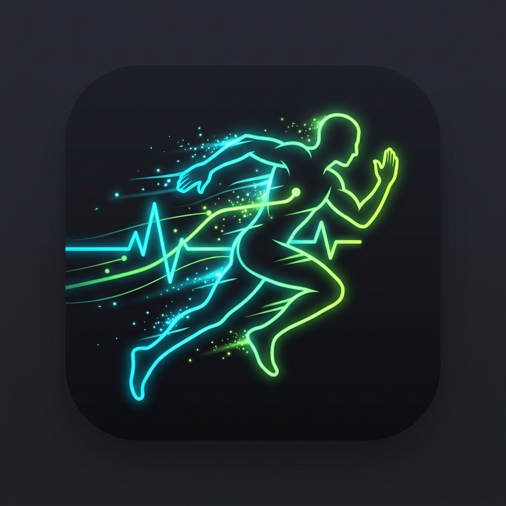
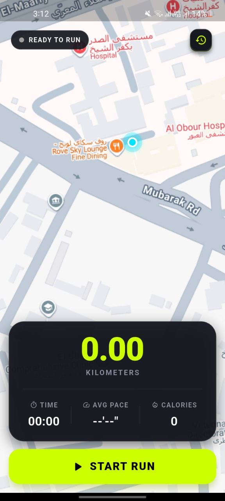
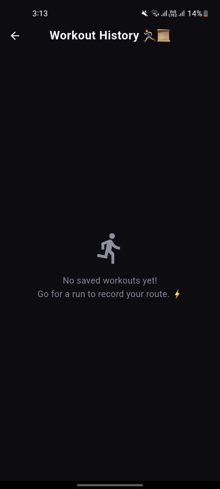
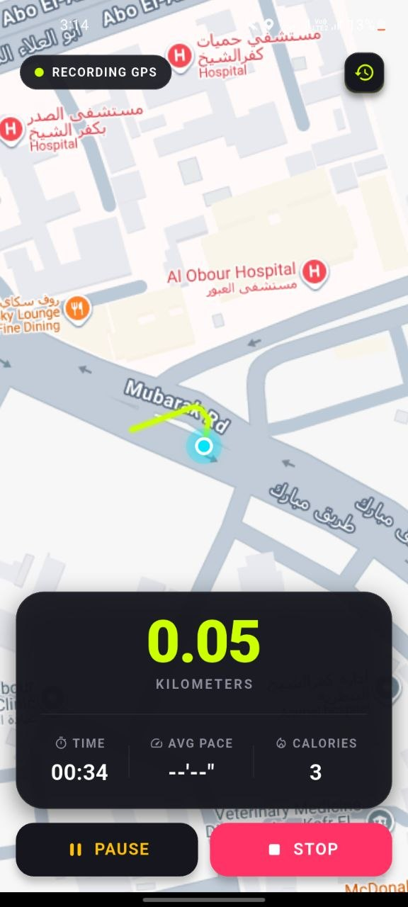
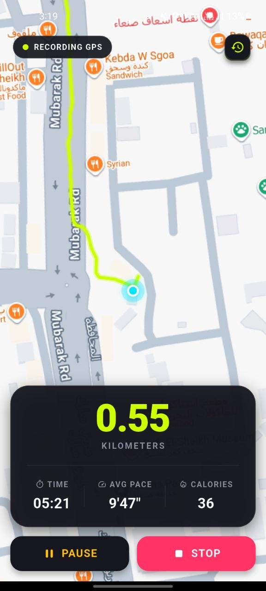
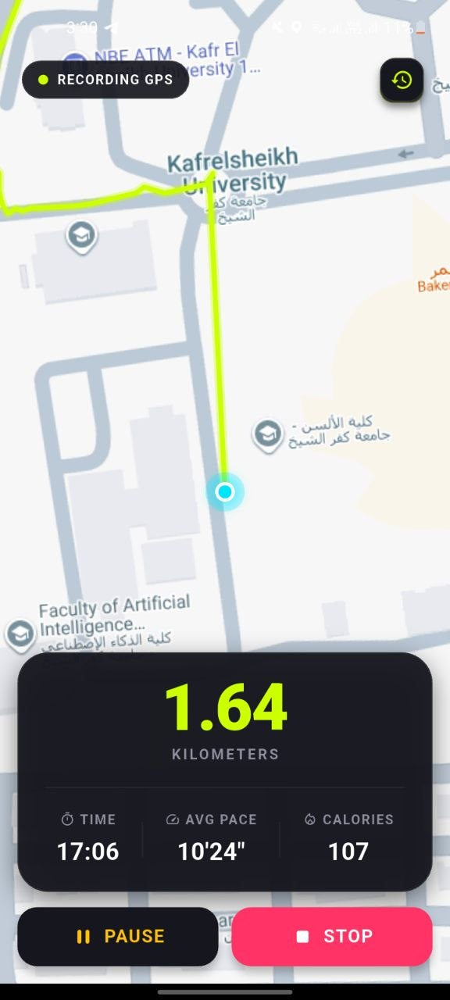
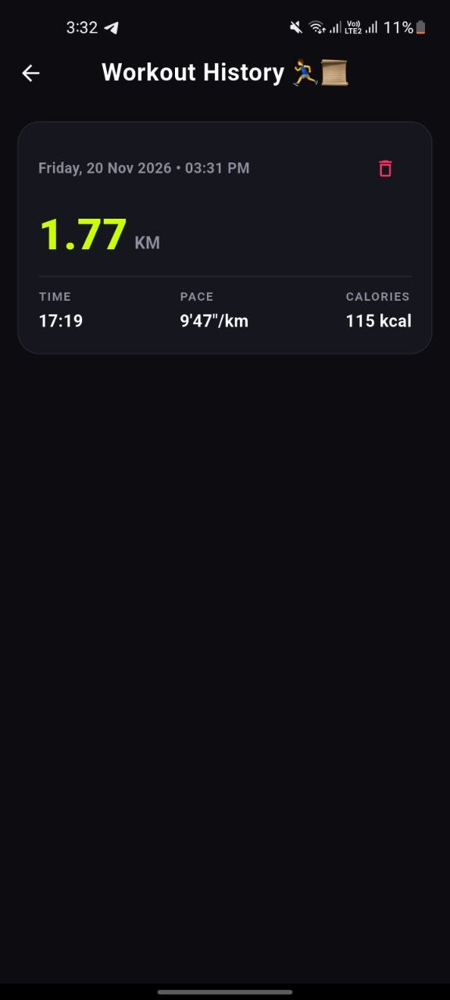

# 🏃‍♂️ RunPulse — Real-Time GPS Fitness & Route Tracker

<p align="center">
  
</p>

<p align="center">
  <b>A production-grade, offline-capable GPS Fitness & Route Tracking Flutter application built with Clean Architecture, BLoC Pattern, OpenStreetMap, and Hive local persistence.</b>
</p>

<p align="center">
  
  
  
  
  
  
</p>

---

## 🌟 Key Highlights & Engineering Features

- 🛰️ **High-Frequency GPS Stream**: Uses `geolocator` with navigation-grade accuracy and a 3-meter distance filter to capture location coordinates seamlessly.
- ⚡ **Live Neon Polyline Rendering**: Draws a multi-layered glowing laser route on OpenStreetMap (`flutter_map`) in real-time as the runner moves, paired with auto-following camera controls.
- 🧮 **Precision Athletic HUD (Heads-Up Display)**: Computes live distance via the **Haversine formula**, exact pace (`min/km`), workout duration via millisecond timers, and calorie burn estimations using METs formulas.
- 💾 **Offline-First Persistence (Hive DB)**: Saves full workout routes, date stamps, and metrics to an ultra-fast local Hive database without requiring internet connectivity or external APIs.
- 🎨 **Athletic Dark Theme**: Custom dark-mode UI inspired by Nike Run Club and Strava featuring Electric Volt Lime (`#CCFF00`) and Neon Cyan accents.
- 🏗️ **Clean Architecture**: Decoupled into **Domain**, **Data**, and **Presentation** layers adhering to SOLID principles and Dependency Inversion (`get_it`).

---

## 🧮 Mathematical & Physics Formulas

1. **Distance Calculation (Haversine Formula):**
   ```text
   Distance = Geolocator.distanceBetween(lat1, lon1, lat2, lon2)
   ```
2. **Pace Computation (Minutes per Kilometer):**
   ```text
   Pace = Duration (in Minutes) / Distance (in KM)
   ```
3. **Calorie Burn Formula (METs):**
   ```text
   Calories = Distance (KM) * 65 kcal (standardized for average runner)
   ```

---

## 📱 App Screenshots

| Live Tracking & Map | Workout Summary Dialog | Workout History (Hive) |
| :---: | :---: | :---: |
|  |  |  |

---

## 📐 Architecture Overview

The application strictly adheres to Uncle Bob's **Clean Architecture** patterns:

```
lib/
├── core/
│   ├── constants/       # Map tile configurations, box names, filter meters
│   ├── errors/          # Custom LocationFailure & StorageFailure
│   ├── theme/           # Athletic Dark Neon Volt & Cyan styling
│   └── utils/           # FitnessCalculators (Distance, Pace, Calories, Duration)
│
├── features/
│   ├── tracking/        # Live GPS tracking, LiveMapWidget, HUD Dashboard, TrackingBloc
│   └── history/         # Workout history listing, Hive LocalDataSource, HistoryBloc
│
├── injection_container.dart  # Service Locator (GetIt) setup
└── main.dart                 # App Entrypoint & MultiBlocProvider
```

---

## 🚀 Getting Started

### 1. Prerequisites
- [Flutter SDK](https://flutter.dev/docs/get-started/install) (>= 3.3.0)
- Android / iOS device or emulator with Location permissions enabled.

### 2. Installation
```bash
git clone https://github.com/Yousef-Hesham5839/runpulse-fitness-tracker.git
cd runpulse-fitness-tracker
flutter pub get
```

### 3. Generate App Icons (Optional)
```bash
dart run flutter_launcher_icons
```

### 4. Run the Project
```bash
flutter run
```


---

## 👨‍💻 Author
**Yousef Hesham**  
- GitHub: [@Yousef-Hesham5839](https://github.com/Yousef-Hesham5839)


## 📱 App Screenshots & User Journey

### 🏃‍♂️ Live Workout & Real-Time Tracking Flow
| 1. App UI | 2. Empty History | 3. Running |
| :---: | :---: | :---: |
|  |  |  |

### 🏆 Workout Summary & Local History (Hive DB)
| 4. Running | 5. Running | 6. Run Details & Metrics |
| :---: | :---: | :---: |
|  |  |  |